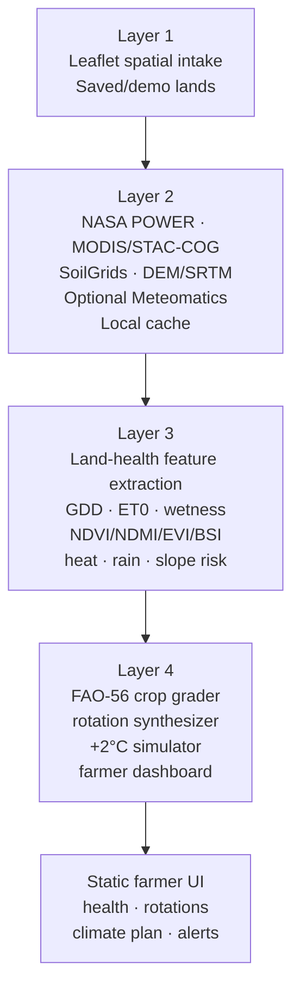

# Alpha Orbit — Adapting Farms with NASA Data

[](./LICENSE)
[](#data-sources-attribution-and-licenses)
[](./Hamdi/app/main.py)
[](./Hamdi/backend/tests/test_engine_validity.py)

**NASA Space Apps Challenge track:** *Field Shift: Adapting Farms with NASA Data*

Alpha Orbit is a farmer-facing decision-support prototype. It turns a drawn field boundary into a concise land-health summary, crop suitability ranking, multi-year rotation options, a transparent +2°C comparison, and optional tactical weather alerts. It is designed to **augment local agronomic judgment**, not replace the farmer, extension officer, or site-specific field measurements.

## Executive overview

Climate volatility makes the same crop plan less reliable from one season to the next. Heat waves, water scarcity, soil degradation, bare ground, and runoff risk can interact in ways that are difficult to evaluate from a single weather station or a static crop calendar.

Alpha Orbit combines:

- A Leaflet map for drawing a WGS84 field polygon.
- NASA POWER daily weather and derived FAO-56 reference evapotranspiration.
- NASA MODIS and public STAC/COG imagery where available.
- SoilGrids soil chemistry and texture estimates.
- DEM-derived elevation and slope.
- A 33-crop agronomic catalogue and data-driven crop/rotation scoring.
- A transparent historical-temperature `+2°C` sensitivity scenario.
- Local saved lands for a farmer portfolio.
- An optional Meteomatics 10-day forecast and alert page when trial credentials are configured.
- A one-click, client-side A4 PDF action and grant report using `jsPDF`, with a browser print fallback.

External providers can be unavailable or rate-limited. The application preserves partial results and reports source warnings instead of silently treating missing data as a measurement.

## Challenge alignment

| Space Apps deliverable | Alpha Orbit implementation | Evidence in this repository |
|---|---|---|
| Environmental stressor diagnostics | GDD with a 10°C base, days above 35°C, root-zone wetness, FAO-56 Penman–Monteith `ET₀`, rainfall, bare-ground exposure, heavy-rain windows, and slope/runoff vulnerability | [`data_fetcher.py`](./Hamdi/backend/services/data_fetcher.py), [`test_engine_validity.py`](./Hamdi/backend/tests/test_engine_validity.py) |
| 30+ crop grader | Scores all 33 catalogue entries and returns a worst-to-best list with water demand, deficit, yield, margin, nitrogen, rooting, erosion, strengths, and risks | [`crop_database.json`](./Hamdi/backend/data/crop_database.json), [`crop_scorer.py`](./Hamdi/backend/services/crop_scorer.py) |
| Four rotation strategies | Builds a conventional fallow baseline, cereal–legume–cover, water-conservation, and high-margin soil-building strategies from the parcel scores | [`crop_scorer.py`](./Hamdi/backend/services/crop_scorer.py) |
| Farmer priorities | The UI offers `Save water`, `Handle heat`, and `Protect income` priority controls that reorder climate rotation cards | [`app.js`](./Hamdi/static/app.js), [`index.html`](./Hamdi/static/index.html) |
| `+2°C` scenario | Adds 2°C to daily temperatures, recalculates GDD and FAO-56 `ET₀`, counts heat days, estimates crop irrigation changes, and produces planting/rotation recommendations | [`climate_engine.py`](./Hamdi/backend/services/climate_engine.py) |
| Multi-land management and tactical alerts | Local saved/demo parcels, active-land switching, centroid-targeted optional 10-day Meteomatics forecasts, and frost/heat/rain/wind alerts | [`app.js`](./Hamdi/static/app.js), [`meteomatics_service.py`](./Hamdi/backend/services/meteomatics_service.py) |
| One-click action/grant report | Builds a print-optimized 1–2 page report from active localStorage parcel data, land-health metrics, crop/rotation scores, +2°C results, and loaded forecast alerts; downloads through `jsPDF` or falls back to `window.print()` | [`index.html`](./Hamdi/static/index.html), [`app.js`](./Hamdi/static/app.js), [`styles.css`](./Hamdi/static/styles.css) |

### Current implementation boundaries

For transparent judging, the current code does **not** claim features that are not present:

- `ETₐ` is not independently observed or solved as a separate satellite product. The engine exposes reference `ET₀`, root-zone wetness, rainfall, and an irrigation-need proxy from crop demand minus seasonal rainfall.
- The priority controls are buttons, not continuous sliders.
- PDF generation is intentionally client-side: `jsPDF` is loaded from a CDN and writes the report directly, while `window.print()` with `@media print` styling is the browser fallback. No OS-dependent PDF package or backend PDF route is required.
- Meteomatics is optional. Without credentials, the rest of the open-data pipeline remains usable and the forecast page reports an unavailable state.

## Quick start

### Repository layout

The Git repository intentionally contains one top-level application directory:

```text
Alpha-Orbit/
├── Hamdi/
│   ├── app/                         # FastAPI application
│   ├── backend/
│   │   ├── data/                    # Generated 33-crop source catalogue
│   │   ├── scripts/                 # Database builder and smoke test
│   │   ├── services/                # Ingestion and agronomic engines
│   │   ├── tests/                   # pytest regression suite
│   │   └── test_fetch.py            # Live Beja environmental smoke test
│   ├── static/                      # HTML, CSS, and browser JavaScript
│   ├── requirements.txt
│   └── .env.example
├── LICENSE
└── README.md
```

There is no separate `frontend/` directory: the frontend is the static application in `Hamdi/static/`. There is no root-level `scripts/` directory: operational scripts are in `Hamdi/backend/scripts/`.

### Requirements

- Python 3.10+ recommended.
- Network access for live NASA, ISRIC, STAC, map, and optional Meteomatics requests.
- A modern browser with JavaScript enabled.

### Install

```bash
cd Alpha-Orbit/Hamdi
python3 -m venv .venv
source .venv/bin/activate
python -m pip install --upgrade pip
python -m pip install -r requirements.txt
```

The checked-in requirements are the source of truth:

```text
fastapi, uvicorn, shapely, pyproj, httpx, pystac-client,
rioxarray, rasterio, xarray, numpy, python-dotenv, pytest
```

### Configure optional services

```bash
cp .env.example .env
```

The only documented optional credentials are:

```dotenv
METEOMATICS_USER=your_meteomatics_username
METEOMATICS_PASS=your_meteomatics_password
```

`EARTHDATA_TOKEN` is also read if present for authenticated ECOSTRESS/STAC access, but it is not required for the core application. Never commit `.env`; it is ignored by [`Hamdi/.gitignore`](./Hamdi/.gitignore).

### Run the web application

From `Alpha-Orbit/Hamdi`:

```bash
source .venv/bin/activate
PYTHONPATH=. python -m uvicorn app.main:app --host 127.0.0.1 --port 8000
```

Open <http://127.0.0.1:8000/>.

For development auto-reload:

```bash
PYTHONPATH=. python -m uvicorn app.main:app --reload --host 127.0.0.1 --port 8000
```

Port `8001` is not a different application; it is simply another server process if you choose to start one there. Run one process at a time to avoid confusion.

## API reference

The FastAPI application is [`Hamdi/app/main.py`](./Hamdi/app/main.py). Interactive OpenAPI documentation is available at `/docs` while the server is running.

### `POST /api/spatial/process`

Validates a GeoJSON `Feature` containing a `Polygon`, calculates a WGS84 centroid and bounding box, and computes projected area/perimeter using a local UTM CRS.

```bash
curl -X POST http://127.0.0.1:8000/api/spatial/process \
  -H 'Content-Type: application/json' \
  -d '{
    "type": "Feature",
    "properties": {},
    "geometry": {
      "type": "Polygon",
      "coordinates": [[
        [9.18055, 36.72445],
        [9.18285, 36.72445],
        [9.18285, 36.72675],
        [9.18055, 36.72675],
        [9.18055, 36.72445]
      ]]
    }
  }'
```

Coordinates are `[longitude, latitude]` in EPSG:4326. The response includes `centroid`, `bbox`, `area`, `perimeter`, `projection`, `geojson`, and `geometry_valid`.

### `POST /api/data/fetch`

Runs the environmental bundle and stages 3–5. It expects the output geometry and spatial values from `/api/spatial/process`:

```json
{
  "centroid": {"latitude": 36.7256, "longitude": 9.1817},
  "bbox": [9.18055, 36.72445, 9.18285, 36.72675],
  "geojson_geometry": {
    "type": "Polygon",
    "coordinates": [[[9.18055, 36.72445], [9.18285, 36.72445],
                    [9.18285, 36.72675], [9.18055, 36.72675],
                    [9.18055, 36.72445]]]
  }
}
```

The response contains `weather_summary`, `daily_weather`, `soil_profile`, `terrain_slope`, `modis`, `optical_indices`, `stage3_indicators`, `stage4_agronomics`, `stage5_climate`, `data_sources_used`, `cache_key`, and `warnings`.

Provider failures are isolated where possible. A successful response may include a `warnings` array, for example when MODIS has no usable subset or no public optical scene is available.

### `POST /api/rotations/custom`

Evaluates any three crop IDs from the 33-crop catalogue:

```json
{
  "crop_ids": ["corn", "soybeans", "winter_rye"],
  "weather": {},
  "stage3": {},
  "soil": {},
  "terrain": {}
}
```

In the UI, the weather/stage3/soil/terrain values come from the latest completed land analysis.

### `POST /api/forecast/alerts`

Requests the optional centroid-targeted 10-day forecast:

```json
{
  "lat": 36.7256,
  "lon": 9.1817,
  "land_name": "Beja Demo Farm",
  "slope_pct": 4.2,
  "top_crop": {"crop_id": "sorghum", "name": "Grain Sorghum"}
}
```

With no Meteomatics credentials it returns `available: false` and an actionable reason. With credentials it returns normalized daily values and generated alerts.

### Other routes

| Route | Purpose |
|---|---|
| `GET /` | Serves the farmer dashboard |
| `GET /api/geocode?query=...` | Nominatim place-name search |
| `GET /api/data/layer/{cache_key}/{layer}.png` | Serves cached `ndvi`, `evi`, `ndmi`, or `bsi` overlays when available |

## System architecture



### Four-layer breakdown

1. **Spatial intake:** Leaflet and Leaflet.draw create a valid polygon. The FastAPI spatial route validates WGS84 coordinates and computes geodesic-useful projected measurements in a suitable UTM zone.
2. **Ingestion and cache:** `data_fetcher.py` concurrently requests NASA POWER, SoilGrids, MODIS, public STAC/COG imagery, and terrain. Results and raster arrays are cached under `Hamdi/cache/`, which is ignored by Git.
3. **Feature extraction:** Provider sentinels are removed, MODIS scale factors are applied, soil values are normalized, and daily records feed GDD, ET₀, moisture, vegetation, bare-ground, heat, heavy-rain, and erosion indicators.
4. **Decision layer:** Crop assessments and four rotation strategies are generated, then the climate engine repeats thermal and water calculations under +2°C. The static UI presents concise farmer actions and technical details.

## Data sources, endpoints, and licenses

The table distinguishes data sources used by the current code from documented extension points and optional partner services.

| Provider | Datasets / parameters used | Endpoint or access method | Open status | License and attribution |
|---|---|---|---|---|
| NASA POWER | `T2M`, `T2M_MAX`, `T2M_MIN`, `PRECTOTCORR`, `ALLSKY_SFC_SW_DWN`, `RH2M`, `WS2M`, `GWETTOP`, `GWETROOT`; `community=AG` | `https://power.larc.nasa.gov/api/temporal/daily/point` | Open data | NASA Open Data Policy / U.S. Government public domain. Attribute NASA POWER. |
| NASA ORNL DAAC MODIS subsets | `MOD13Q1` NDVI/EVI and `MOD09A1` reflectance bands used for NDMI | `https://modis.ornl.gov/rst/api/v1/` | Open data | NASA Open Data Policy / U.S. Government public domain. Attribute NASA ORNL DAAC and MODIS. |
| NASA Earthdata CMR-STAC | Public STAC search for optical/DEM/COG assets; authenticated ECOSTRESS path reads `EARTHDATA_TOKEN` when configured | `https://cmr.earthdata.nasa.gov/stac/LPCLOUD` | Open data; some access may require a free Earthdata account | NASA Open Data Policy / U.S. Government public domain. Attribute NASA Earthdata/Land Processes DAAC. |
| Element 84 Earth Search | Sentinel-2 and DEM STAC discovery and COG assets | `https://earth-search.aws.element84.com/v1` | Open data catalog | Asset-specific provider terms apply. Copernicus Sentinel-2 and Copernicus DEM data are governed by the Copernicus Data Policy, including CC BY-SA 3.0 IGO where applicable. NASA SRTM-derived assets are U.S. Government public domain where applicable. |
| EOX IT Services | Sentinel-2 Cloudless 2025 basemap tiles | `https://tiles.maps.eox.at/wmts/1.0.0/s2cloudless-2025_3857/default/g/{z}/{y}/{x}.jpg` | Open access basemap | CC BY-SA 4.0; attribution: EOX IT Services GmbH; contains modified Copernicus Sentinel data. |
| OpenStreetMap | Street basemap tiles | `https://{s}.tile.openstreetmap.org/{z}/{x}/{y}.png` | Open data | Open Database License (ODbL); © OpenStreetMap contributors. |
| Nominatim | Place-name geocoding | `https://nominatim.openstreetmap.org/search` | Open service subject to usage policy | ODbL for the underlying OpenStreetMap data; Nominatim software is GPLv2. Respect the Nominatim usage policy and identify a user agent. |
| ISRIC SoilGrids 2.0 | `soc`, clay, sand, silt, `phh2o`, nitrogen, water-content properties | `https://rest.isric.org/soilgrids/v2.0/properties/query` with a documented fallback URL | Open data | CC BY 4.0; attribute ISRIC — World Soil Information and SoilGrids. |
| FAO-56 / FAO AquaCrop references | Crop coefficients `Kc`, root depth `Zr`, depletion fraction `p`, and yield-response context | Reproducible catalogue builder plus FAO Irrigation and Drainage Paper 56 references | Open scientific references | FAO publications and standards are cited as the scientific source; verify and preserve the applicable FAO publication terms when redistributing derived tables. |
| `pyfao56` reference | The catalogue builder includes `pyfao56` in `requirements.txt`, but the runtime catalogue is generated JSON and does not import the package directly | Reference used during catalogue preparation; not a runtime API | Open-source reference, not a runtime component | The package's repository license must be checked before redistributing any package-derived material. The current project does not vendor `pyfao56`. |
| USDA PLANTS / USDA NASS | Plant functional traits and benchmark context referenced by the catalogue | `https://plants.sc.egov.usda.gov/` and `https://quickstats.nass.usda.gov/api` | U.S. Government open data | U.S. Government public domain, subject to each service's terms and attribution guidance. |
| World Bank Commodity Markets | Commodity and fertilizer benchmark context referenced by the catalogue documentation | `https://www.worldbank.org/en/research/commodity-markets` | Open data | CC BY 4.0 where the specific Pink Sheet release is marked under that license; attribute the World Bank and the release/version used. |
| Meteomatics | Optional 10-day temperature, precipitation, ET, soil-moisture index, frost, heavy-rain, thunderstorm, and wind parameters | `https://api.meteomatics.com/` | Commercial partner trial; optional | Meteomatics terms/trial license apply. Do not treat this as an open-data dependency. The app falls back to `available: false` when credentials are absent. |

### Open-data transparency

The core historical environmental workflow is intended to run without Meteomatics credentials. Provider availability, rate limits, cloud cover, missing optical scenes, and Earthdata authentication can change the returned bundle. Every returned bundle carries `warnings` where the application can continue with partial data.

## Open-source software stack and licenses

| Component | Role | License |
|---|---|---|
| Python | Runtime | Python Software Foundation License |
| FastAPI | API framework | MIT |
| Uvicorn | ASGI server | BSD-3-Clause |
| HTTPX | Async HTTP client | BSD-3-Clause |
| Pydantic (transitive FastAPI dependency) | Validation/modeling | MIT |
| NumPy | Numerical arrays and statistics | BSD-3-Clause |
| Shapely | Geometry validation and projection inputs | BSD-3-Clause |
| pyproj / PROJ | Coordinate reference systems and UTM transforms | MIT / X/MIT-style PROJ license; see installed distribution notices |
| rasterio | Raster access and clipping | BSD-3-Clause |
| rioxarray | Xarray/raster geospatial operations | Apache-2.0 |
| xarray | Labeled scientific arrays | Apache-2.0 |
| pystac-client | STAC catalog access | Apache-2.0 |
| python-dotenv | `.env` loading | BSD-3-Clause |
| pytest | Regression testing | MIT |
| Leaflet.js | Interactive map | BSD-2-Clause |
| Leaflet.draw | Polygon drawing/editing | MIT |
| Turf.js | Browser geometry calculations | MIT |
| Chart.js | Forecast chart | MIT |
| jsPDF | Client-side PDF download from live report values | MIT |

The browser loads Leaflet, Leaflet.draw, Turf.js, Chart.js, and jsPDF from CDNs as declared in [`static/index.html`](./Hamdi/static/index.html). Review the corresponding CDN versions and retain their license notices when packaging or redistributing the frontend.

## Scientific methodology

### Spatial measurements

Input coordinates are WGS84 longitude/latitude pairs. The spatial endpoint chooses a UTM zone from the polygon centroid, projects the polygon, and reports:

```text
area_ha = projected_area_m² / 10,000
acres   = projected_area_m² / 4,046.8564224
```

This avoids treating degrees as meters and is validated by a known approximately 100-hectare test polygon.

### FAO-56 reference evapotranspiration

For each complete NASA POWER daily record, the engine uses the FAO-56 daily Penman–Monteith form:

```text
ET₀ = [0.408 Δ (Rn − G) + γ · 900/(T + 273) · u₂ · (eₛ − eₐ)]
      / [Δ + γ(1 + 0.34u₂)]
```

The implementation estimates extraterrestrial radiation and clear-sky radiation from latitude and day of year, derives net shortwave/longwave radiation, and uses NASA temperature, humidity, radiation, and wind inputs. The Uccle, Belgium FAO-56 benchmark in the test suite returns approximately 3.787 mm/day.

### GDD and heat stress

The daily growing degree contribution is:

```text
GDD_day = max(0, min(Tmax + Tmin, 70) / 2 − 10)
```

The implementation caps the daily mean at 35°C before subtracting a 10°C base. Heat-stress windows count days where `T2M_MAX > 35°C`.

### Crop water demand and irrigation proxy

For a crop with growing-season length `D` and mid-season coefficient `Kc_mid`:

```text
ETc_proxy_mm = ET₀_mean_mm_day × D × Kc_mid
seasonal_rain_mm = annual_rainfall_mm × D / 365
deficit_mm = max(0, ETc_proxy_mm − seasonal_rain_mm)
irrigation_need_m³_ha = deficit_mm × 10
```

The `×10` conversion follows `1 mm over 1 hectare = 10 m³`. This is a planning proxy, not a field irrigation prescription or a measured `ETₐ`.

### Crop scoring

The current scorer combines normalized water availability, root-zone wetness, available water capacity, slope, and heat exposure:

```text
score = 100 × (
    0.38 water_factor +
    0.20 wetness_factor +
    0.16 soil_factor +
    0.10 slope_factor +
    0.16 heat_factor
)
```

Projected yield is baseline yield multiplied by a water factor and heat penalty. Net margin is:

```text
net_margin = projected_yield_t_ha × market_price_usd_t
             − production_cost_usd_ha
```

The catalogue is generated by [`build_crop_database.py`](./Hamdi/backend/scripts/build_crop_database.py) into both:

- [`backend/data/crop_database.json`](./Hamdi/backend/data/crop_database.json)
- [`backend/services/crop_database.json`](./Hamdi/backend/services/crop_database.json)

### Rotation synthesis

Four data-driven sequences are returned:

1. Conventional baseline: best-scoring cereal → fallow → best-scoring cereal.
2. Adaptive cereal–legume–cover: best cereal → best legume → best cover crop.
3. Water-conservation resilience: top +2°C / low-demand candidates.
4. High-margin soil-building: highest-margin crop → best legume → best cover crop.

Each rotation aggregates water use, supplemental income, fertilizer savings, nitrogen contribution, baseline suitability, and +2°C suitability. The `fallow` sentinel is handled explicitly by the climate engine.

### +2°C sensitivity scenario

The climate engine adds `warming_c` (default `2.0`) to daily `T2M`, `T2M_MAX`, and `T2M_MIN`, then repeats GDD and ET₀ calculations. It compares:

- baseline versus scenario GDD;
- baseline versus scenario total ET₀;
- baseline versus scenario heat-stress days;
- crop-specific extra irrigation in m³/ha;
- crop heat/yield-factor risk;
- planting shifts and rotation actions.

This is a deterministic sensitivity analysis. It does not forecast future precipitation, CO₂ fertilization, cultivar adaptation, or pest dynamics.

### Spectral and soil indicators

For valid reflectance arrays, the engine computes:

```text
NDVI = (NIR − Red) / (NIR + Red)
NDMI = (NIR − SWIR1) / (NIR + SWIR1)
EVI  = 2.5 × (NIR − Red) / (NIR + 6Red − 7.5Blue + 1)
BSI  = ((SWIR1 + Red) − (NIR + Blue))
       / ((SWIR1 + Red) + (NIR + Blue))
```

Indices are bounded to `[-1, 1]` where applicable. Provider fill values such as MODIS `-3000` and `-9999` are discarded, and the MODIS/Sentinel scaling path applies the documented `0.0001` reflectance scale.

## Verification and reproducibility

### Focused regression suite

From `Alpha-Orbit/Hamdi`:

```bash
PYTHONPATH=. python -m pytest backend/tests/test_engine_validity.py -v -s
```

The suite covers:

- FAO-56 ET₀ benchmark accuracy.
- GDD warm-day and cold-day clamping.
- NDVI/NDMI bounds.
- Polygon area and exact centroid behavior.
- NASA POWER `-999` filtering and solar-unit preservation.
- SoilGrids normalization.
- MODIS fill-value and scale handling.
- +2°C monotonicity and complete crop/rotation recommendations.
- Stage 4 bounded outputs.
- Meteomatics fallback and endpoint input validation.

The latest verified result for this repository was **6 passed** with one existing Shapely deprecation warning.

### Crop database regeneration

```bash
cd Alpha-Orbit/Hamdi
PYTHONPATH=. python backend/scripts/build_crop_database.py
```

The generator is deterministic and writes the two runtime/data JSON copies. Review the generated diff before committing catalogue changes.

### Environmental fetch smoke test

```bash
cd Alpha-Orbit/Hamdi
PYTHONPATH=. python backend/scripts/troubleshoot_environment_fetch.py
```

This checks a Beja polygon and a second small polygon through the direct environmental bundle path. A successful run requires at least one NASA POWER observation, Stage 4 rotations, and a Stage 5 +2°C scenario. Optional provider warnings are printed.

The older live script is:

```bash
cd Alpha-Orbit/Hamdi/backend
PYTHONPATH=. python test_fetch.py
```

It uses the Beja, Tunisia smoke-test polygon and makes live provider requests.

## Demo flow for judges

1. Start the server and open <http://127.0.0.1:8000/>.
2. Select **1-Click Demo Farmer Login**.
3. Open **Beja Cereal Parcel**, **Iowa Rain-fed Farm**, or **Santiago Dry Field**.
4. Open **Land Health & Data** and inspect the plain-English cards.
5. Expand technical details to show NASA/FAO-56 values.
6. Open **Best Rotations** and switch between save-water, heat, and income priorities on the +2°C page.
7. Open **Test My Own Rotation**, choose three crops, and submit the custom sequence.
8. Open **10-Day Weather & Alerts**. With Meteomatics credentials, switch parcels and inspect the forecast; without credentials, show the intentional unavailable state.
9. To test a real parcel, choose **+ Add / Draw New Land**, draw a valid closed polygon, wait for **Processing → Ready**, then fetch environmental data.
10. Click **▣ Export PDF Report** from the active parcel bar, Land Health, or Best Rotations view to download the executive action/grant report or open the clean browser print preview.

The report includes parcel identity, health score and four diagnostic metrics, best-versus-avoid crop highlights, conventional-versus-recommended rotation gains, +2°C resilience, the current 10-day field watch, and open-data attribution.

## Project status / build tracker

- Stage 1 — Spatial intake and polygon analysis: **[DONE]**
- Stage 2 — NASA, soil, satellite, and terrain ingestion: **[DONE]**
- Stage 3 — Land-health indicators and FAO-56 diagnostics: **[DONE]**
- Stage 4 — Crop grading and multi-strategy rotations: **[DONE]**
- Stage 5 — +2°C climate scenario simulator and tactical alerts: **[DONE]**
- Stage 6 — Farmer portal, concise dashboard, and PDF action/grant report: **[DONE]**

## Limitations, risks, and responsible use

- NASA POWER is a gridded point product, not an on-field sensor.
- SoilGrids and DEM values are spatial estimates and may miss within-field variability.
- Cloud cover and provider outages can remove optical or MODIS observations.
- Crop values are benchmark parameters, not cultivar-, market-, or farm-specific guarantees.
- Yield, margin, fertilizer savings, and irrigation values are comparative model outputs.
- No recommendation should override local soil tests, water rights, disease scouting, weather warnings, or agronomist advice.
- Forecast alerts are optional and depend on Meteomatics credentials, quota, and API availability.
- Do not expose Meteomatics or Earthdata credentials in the browser or commit them to Git.

## Attribution checklist

When presenting or deploying Alpha Orbit, retain:

- “NASA POWER, NASA MODIS, NASA Earthdata, and NASA SRTM” attribution for NASA-derived data.
- “Copernicus Sentinel data / Copernicus DEM” attribution for Copernicus-derived assets.
- “ISRIC — World Soil Information, SoilGrids” attribution.
- “© OpenStreetMap contributors” and ODbL notice for OSM maps.
- EOX CC BY-SA attribution for the Sentinel-2 Cloudless basemap.
- Meteomatics attribution and trial terms if the optional forecast module is enabled.
- The open-source notices for the software stack listed above.

## License

The Alpha Orbit source code is released under the [MIT License](./LICENSE). Third-party datasets, APIs, imagery, maps, and optional partner services remain subject to their own licenses and terms listed in this README.
